# Predicción de abandono de clientes — Telco Customer Churn

**MLY1101 Machine Learning · Evaluación Parcial N°2 · Caso A**
**Integrantes:** Nicolás Garrido · Karen Manríquez · Felipe Espinoza

Este es el informe de nuestro proyecto. Todo el código está en [`notebooks/churn_telco.ipynb`](notebooks/churn_telco.ipynb) y los gráficos en [`images/`](images/).

---

## Resumen

- El **26,5 %** de los clientes abandona la empresa, lo que equivale a **USD 139.131 al mes** (30,5 % del ingreso).
- Probamos dos modelos y el mejor fue **Random Forest**: detecta al **76 %** de los clientes que se van y tiene un **ROC-AUC de 0,846**.
- Con **K-Means** encontramos 4 grupos de clientes. El grupo **"Fibra mes a mes"** tiene **54 % de churn** y concentra cerca del **72 % del ingreso en riesgo**.
- Si se usa el modelo para elegir a quién contactar, se llega solo al **37 %** de los clientes y se recupera el **78 % del ingreso en riesgo**.

---

## 1. Problema de negocio

Una empresa de telecomunicaciones está perdiendo muchos clientes. Conseguir un cliente nuevo cuesta más que mantener uno, así que la empresa necesita saber **qué clientes tienen más riesgo de irse** para ofrecerles algo antes de que se vayan.

Lo planteamos como un problema de **clasificación**: predecir si un cliente va a abandonar (`Churn` = Yes o No). Además usamos **clustering** para separar a los clientes en grupos y ver cuáles son más riesgosos.

## 2. Objetivos

**Objetivo general:** crear un modelo que identifique a los clientes con más probabilidad de abandonar, para enfocar las campañas de retención.

**Objetivos específicos:**
1. Hacer un análisis exploratorio para encontrar qué variables se relacionan con el churn.
2. Limpiar y preparar los datos para los modelos.
3. Entrenar y comparar dos modelos supervisados: Regresión Logística y Random Forest.
4. Agrupar a los clientes con K-Means.
5. Interpretar los resultados pensando en el negocio y revisar si el modelo tiene sesgos.

## 3. KPIs

| KPI | Por qué lo usamos | Meta | Resultado |
|---|---|---|---|
| Recall de churn | Lo más caro es no detectar a un cliente que se va | ≥ 0,75 | **0,759 ✓** |
| ROC-AUC | Mide qué tan bien el modelo ordena a los clientes por riesgo | ≥ 0,80 | **0,846 ✓** |
| Lift top 20 % | Cuánto mejor es contactar al 20 % más riesgoso que elegir al azar | ≥ 2,0 | **2,49 ✓** |
| % del ingreso en riesgo capturado | Que el modelo encuentre a los clientes que más pagan | ≥ 70 % | **78 % ✓** |
| Beneficio de la campaña | Que convenga más que contactar a todos | Mayor | **+44 % ✓** |
| Diferencia de recall por género | Que el modelo funcione igual para hombres y mujeres | < 5 puntos | 5,9 puntos, no significativa ⚠ |

## 4. Fuente de datos

Usamos el dataset **Telco Customer Churn** (IBM, publicado en Kaggle) que entregó la asignatura: [`data/Telco_Customer_Churn_Dataset.csv`](data/Telco_Customer_Churn_Dataset.csv).

Tiene **7.043 clientes y 21 columnas**:

| Tipo | Variables |
|---|---|
| Identificador | `customerID` |
| Datos del cliente | `gender`, `SeniorCitizen`, `Partner`, `Dependents` |
| Cuenta | `tenure` (meses como cliente), `Contract`, `PaperlessBilling`, `PaymentMethod`, `MonthlyCharges`, `TotalCharges` |
| Servicios | `PhoneService`, `MultipleLines`, `InternetService`, `OnlineSecurity`, `OnlineBackup`, `DeviceProtection`, `TechSupport`, `StreamingTV`, `StreamingMovies` |
| Objetivo | `Churn` (si el cliente se fue el último mes) |

## 5. Metodología (CRISP-DM)

Seguimos las 6 fases de CRISP-DM:

1. **Comprensión del negocio:** definimos el problema, los objetivos y los KPIs.
2. **Comprensión de los datos:** revisamos la calidad de los datos e hicimos el EDA.
3. **Preparación de los datos:** limpieza, selección de variables, codificación, escalado y división train/test.
4. **Modelado:** Regresión Logística y Random Forest (supervisados) y K-Means (no supervisado).
5. **Evaluación:** métricas en test, impacto en el negocio y revisión ética.
6. **Despliegue:** guardamos el modelo y una lista de clientes ordenada por riesgo.

No fue un proceso lineal: por ejemplo, al revisar los coeficientes del modelo nos dimos cuenta de que `TotalCharges` causaba problemas y volvimos a la preparación para sacarla.

## 6. Preparación y análisis exploratorio (EDA)

### Calidad de los datos
- No hay valores nulos ni filas duplicadas.
- `TotalCharges` venía como texto y tenía **11 valores vacíos**. Todos eran clientes con `tenure = 0`, o sea, clientes nuevos que todavía no habían pagado. Por eso los reemplazamos por **0**.
- No encontramos outliers raros.

### Variable objetivo
Los datos están **desbalanceados**: 73,5 % se queda y 26,5 % se va. Por eso no usamos el accuracy como métrica principal: un modelo que siempre diga "No" tendría 73,5 % de accuracy sin detectar a nadie.

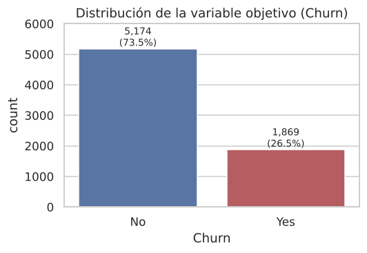

### Lo que encontramos

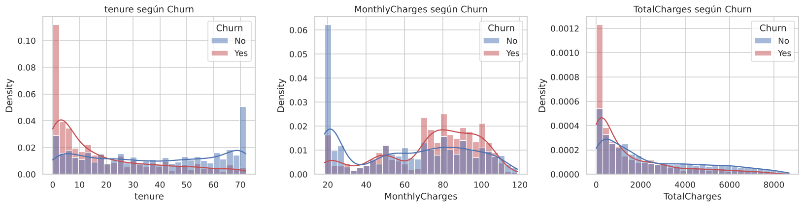

- Los clientes que se van llevan **poco tiempo** en la empresa (mediana de 10 meses vs 38).
- Además pagan **más al mes** (mediana de USD 80 vs 64).

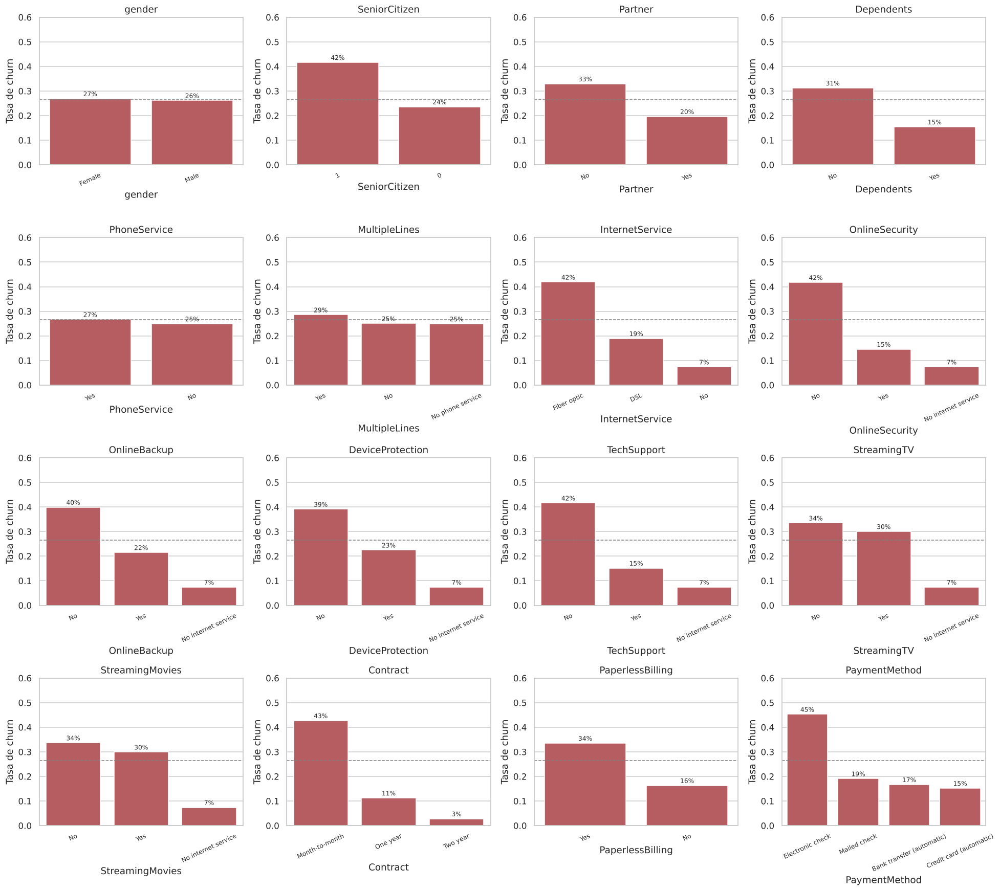

| Variable | Categoría con más churn | Churn | Comparación |
|---|---|---|---|
| Contrato | Mes a mes | 43 % | 11 % un año, 3 % dos años |
| Internet | Fibra óptica | 42 % | 19 % DSL |
| Seguridad online / Soporte técnico | No tiene | 42 % | 15 % si lo tiene |
| Método de pago | Cheque electrónico | 45 % | 15–19 % los demás |
| Adulto mayor | Sí | 42 % | 24 % |

`gender` y `PhoneService` casi no cambian el churn.

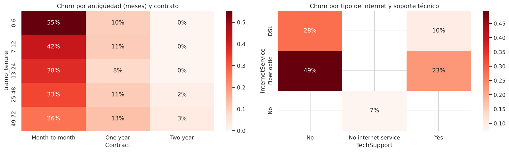

- El peor caso es un cliente con **contrato mes a mes y menos de 6 meses**.
- `TotalCharges` tiene una correlación de **0,83 con `tenure`**, así que aportan casi la misma información.

### Preparación
1. Eliminamos `customerID` porque no sirve para predecir.
2. Sacamos `gender` del modelo porque no influye en el churn y es un dato sensible. Solo la usamos al final para revisar sesgos.
3. Sacamos `TotalCharges` por la alta correlación con `tenure`. Comprobamos que sin ella el modelo funciona igual (ROC-AUC de 0,846 a 0,845).
4. Cambiamos "No internet service" y "No phone service" por "No".
5. Hicimos One-Hot Encoding a las variables categóricas y escalamos las numéricas con `StandardScaler`.
6. Dividimos en **80 % train y 20 % test** con `stratify` para mantener la proporción de churn.
7. Pusimos todo en un `Pipeline` para que el preprocesamiento aprenda solo de los datos de train.

## 7. Modelos supervisados

| Modelo | Por qué lo elegimos |
|---|---|
| Dummy | Lo usamos como base: siempre predice "No". Los otros modelos tienen que superarlo. |
| **Regresión Logística** | Es simple y se puede interpretar con sus coeficientes. |
| **Random Forest** | Puede captar relaciones más complejas entre las variables. |

- En los dos usamos `class_weight="balanced"` por el desbalance.
- Buscamos los mejores hiperparámetros con **GridSearchCV** (5 folds, métrica ROC-AUC).
- En vez de usar 0,5 como umbral, elegimos el que daba el mejor F1 con un recall de al menos 0,75 (0,557 para la logística y 0,541 para el Random Forest).

### Resultados en test

| Modelo | Accuracy | Precision | Recall | F1 | ROC-AUC | Lift top 20 % |
|---|---|---|---|---|---|---|
| Dummy | 0,735 | 0,000 | 0,000 | 0,000 | 0,500 | 1,05 |
| Regresión Logística | 0,752 | 0,524 | 0,733 | 0,611 | 0,839 | 2,51 |
| **Random Forest** | **0,765** | **0,541** | **0,759** | **0,632** | **0,846** | 2,49 |

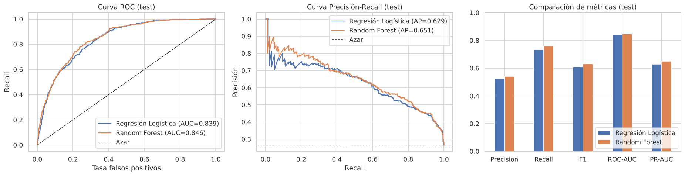
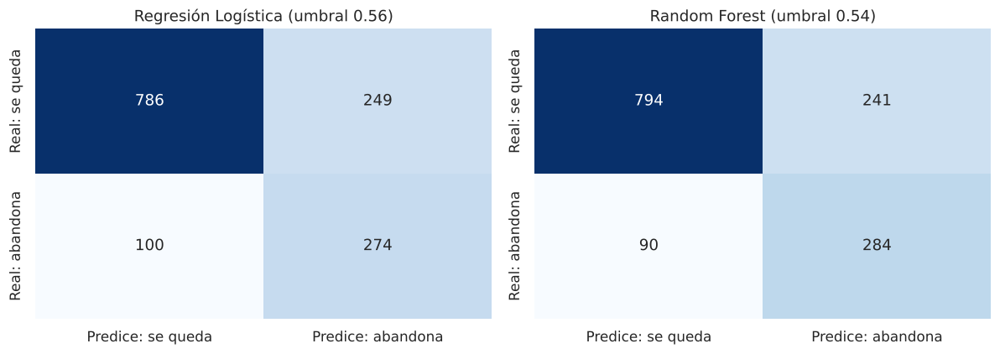

**Elegimos el Random Forest** porque tuvo el mejor ROC-AUC en validación cruzada (0,848 vs 0,845) y es el único que cumple el KPI de recall. La diferencia con la logística es chica, así que la usamos para explicar qué variables influyen.

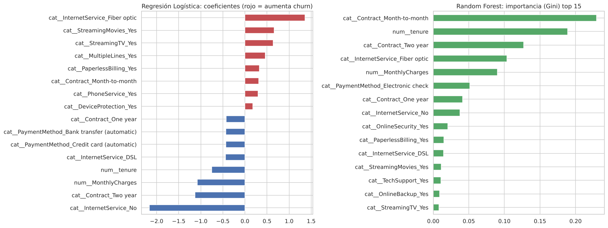

Los dos modelos coinciden en que lo más importante es el **tipo de contrato, la antigüedad, la fibra óptica, el cargo mensual y el método de pago**. Según la logística, tener fibra multiplica por **3,9** las chances de irse, y tener contrato de 2 años las reduce a un tercio (**0,32**).

## 8. Modelo no supervisado: K-Means

Agrupamos a los clientes **sin usar la columna Churn**, con estas variables escaladas: antigüedad, cargo mensual, número de servicios, tipo de contrato, si tiene fibra y si paga automático.

Para elegir el número de grupos usamos el **método del codo** y la **silueta**. Elegimos **k = 4** porque ahí está el codo y los grupos se pueden interpretar bien.

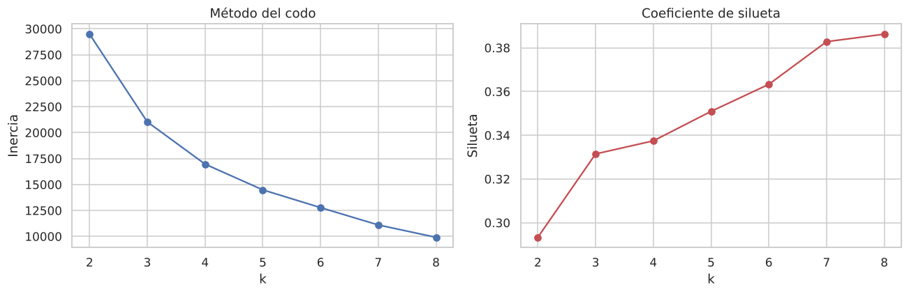
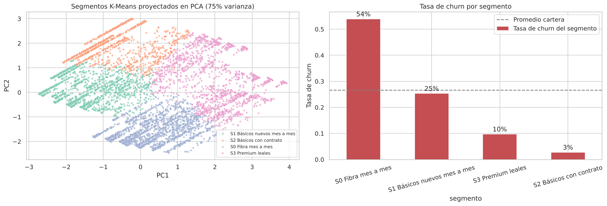
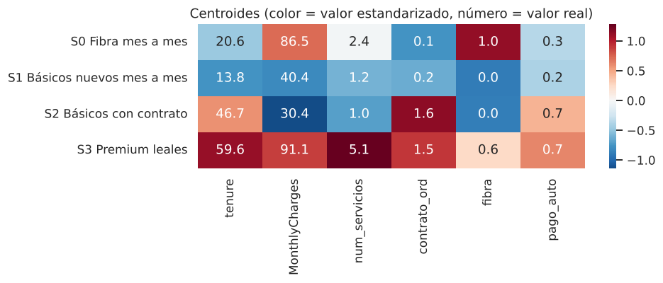

| Grupo | % clientes | Cómo son | Churn | Qué hacer |
|---|---|---|---|---|
| **S0 Fibra mes a mes** | 31 % | Fibra, contrato mensual, ~USD 87 al mes | **54 %** | Prioridad: ofrecer contrato anual con descuento |
| S1 Básicos nuevos mes a mes | 29 % | DSL o solo teléfono, poco tiempo | 25 % | Ofrecer soporte y seguridad, acompañarlos el primer año |
| S3 Premium leales | 24 % | Muchos servicios, ~5 años como clientes | 10 % | Programa de fidelización |
| S2 Básicos con contrato | 17 % | Contrato largo, cargo bajo | 3 % | No gastar en retenerlos |

## 9. Interpretación de resultados

- **Recall 0,76:** de cada 100 clientes que se van, el modelo detecta 76.
- **Precisión 0,54:** de cada 100 clientes que el modelo marca, 54 realmente se van (si eligiéramos al azar serían 26).
- **ROC-AUC 0,85:** el modelo ordena bien a los clientes según su riesgo.
- **Lift 2,5:** contactar al 20 % más riesgoso es 2,5 veces mejor que elegir al azar.

**Simulación de una campaña.** Supusimos que contactar a un cliente cuesta USD 50, que la oferta funciona en el 35 % de los casos y que retener a un cliente vale 12 meses de su cargo mensual:

| Estrategia (1.409 clientes de test) | Contactados | Clientes en riesgo detectados | Beneficio neto (USD) |
|---|---|---|---|
| No hacer nada | 0 | 0 | 0 |
| Contactar a todos | 1.409 | 374 | 43.853 |
| Regresión Logística | 523 | 274 | 62.330 |
| **Random Forest** | **525** | **284** | **63.255** |

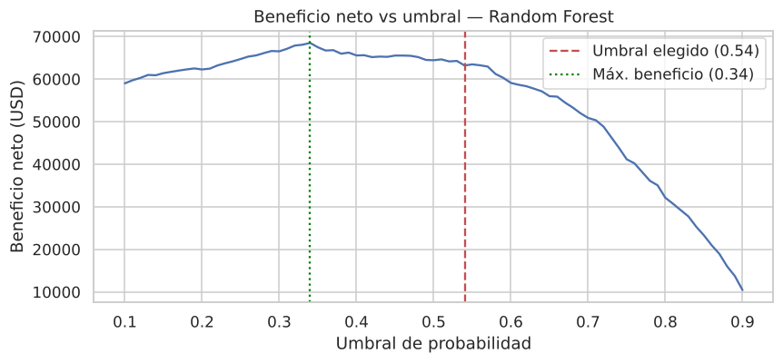

Usar el modelo da un **44 % más de beneficio** que contactar a todos. Si contactar fuera más barato, convendría bajar el umbral a ≈ 0,34.

## 10. Revisión ética

- Sacamos `customerID` y `gender` del modelo, y el dataset no tiene nombres ni datos de contacto.
- **Género:** el recall es 0,73 para mujeres y 0,79 para hombres. La diferencia (5,9 puntos) pasa un poco la meta, pero el test estadístico dice que **no es significativa** (p = 0,18). Igual hay que seguir revisándola.
- **Adultos mayores:** el modelo los marca más porque de verdad se van más (44 % vs 23 %). Como el modelo solo se usa para **ofrecer beneficios**, esto no los perjudica.
- El modelo no debería usarse para subir precios o negar servicios.

## 11. Conclusiones y recomendaciones

El Random Forest cumple los KPIs y es mucho mejor que contactar a todos los clientes. Nuestras recomendaciones son:

1. Ofrecer a los clientes con contrato mes a mes que se pasen a un contrato anual, partiendo por el grupo S0.
2. Revisar el precio y la calidad del servicio de fibra óptica.
3. Incluir soporte técnico y seguridad online en las ofertas de retención.
4. Incentivar el pago automático.
5. Acompañar más a los clientes durante su primer año.

**Limitaciones:** los datos son de un solo momento, no tienen información de reclamos ni de uso, y los costos de la campaña son supuestos nuestros.

---

## Estructura del proyecto

```
telco_churn_ml/
├── README.md                  ← este informe
├── requirements.txt           ← librerías necesarias
├── data/
│   ├── Telco_Customer_Churn_Dataset.csv   ← datos originales
│   └── scoring_clientes_test.csv          ← clientes de test ordenados por riesgo
├── notebooks/
│   └── churn_telco.ipynb      ← notebook con todo el desarrollo
├── models/
│   ├── modelo_churn_final.joblib    ← modelo final (Random Forest con su preprocesamiento)
│   ├── kmeans_segmentacion.joblib   ← modelo K-Means
│   ├── config_modelo.json           ← umbral, variables y métricas
│   └── metricas_test.csv            ← comparación de modelos
├── images/                    ← gráficos del notebook
└── presentacion/
    └── guion_presentacion.md  ← guion para la presentación
```

## Cómo ejecutarlo

1. Instalar las librerías:
   ```bash
   pip install -r requirements.txt
   ```
2. Abrir `notebooks/churn_telco.ipynb` en Jupyter y ejecutar todas las celdas (*Kernel → Restart & Run All*).

El notebook usa rutas relativas y `random_state = 42`, así que siempre da los mismos resultados. Al ejecutarlo se vuelven a crear los gráficos y los archivos de `models/`.
